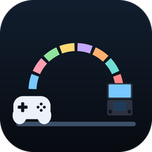

#  PadBridge

[](https://github.com/ajhockey88/PadBridge/releases)
[](https://github.com/ajhockey88/PadBridge/releases/latest)

🎮 Connect your controllers to the AYN Thor once, and your emulators keep their mappings.

🌉 PadBridge bridges the Thor's own controls and up to seven Bluetooth or USB controllers onto
steady player controllers, **PadBridge Player 1**, **Player 2** and so on up to Player 8, which
games see the same way every time. Map them once in each emulator and you're done, whichever
controllers you pick up, for local multiplayer, split screen or streaming.

## 📸 Screens

Everything happens on the Thor's bottom screen (1240 × 1080), with the controller test on the
top screen.

| 🎮 Players, on the bottom screen | 👆 Who is Player 1 |
|---|---|
|  |  |
| 🕹️ A controller's menu | 🤝 Both Player 1 |
|  |  |
| 👥 Four players | 🎉 Up to eight |
|  |  |
| 🔁 Swapping with more than two | 🧪 Controller test (top screen) |
|  |  |
| 🚀 First-run setup | ⚙️ Settings |
|  |  |
| 🕹️ Controllers | 🎛️ A controller's settings |
|  |  |
| ℹ️ About | |
|  | |

The screenshots are drawn from PadBridge's own code with made-up controllers.

## 👆 Using it

PadBridge opens on the bottom screen, so the game on the top screen stays put. Each player has
a card with the controllers on it: two side by side, four in a square, up to eight in two rows.
Once it's on, you can close PadBridge: it keeps running.

- 📱 **Thor first** (the default): the Thor's controls are Player 1, and controllers you
  connect are Player 2, 3, 4 and so on, in the order they connect.
- 🎮 **Controller first**: a connected controller is Player 1 and the Thor's controls are the
  next player. Handy docked, when a friend can still join on the Thor.
- 🤝 **Both Player 1**: the Thor and your first controller both drive Player 1, so you can put
  the Thor down and pick up a controller mid-game. More controllers are Player 2 and up.
- 👥 **−** and **+** next to PLAYERS set how many players games always see, from 1 to 8. A new
  controller still gets the next free player by itself.
- 🔁 **Swap** flips Player 1 and Player 2 in one tap. With more than two players, tap Swap and
  then the two players to swap (📌 their controllers stay there afterwards).
- ⋯ **Tap a controller** to fix it to a player (a numbered chip for each, 1 to 8; 📌 it stays
  there whatever the mode), leave it to Android, open its settings, or mark it as the Thor's own
  controls if PadBridge didn't spot them.
- 🎛️ **A controller's settings:** rumble strength (or off) with a 📳 Test button, stick deadzone
  for worn sticks that drift, invert the right stick up/down, and Nintendo layout (swaps A/B and
  X/Y).
- ⚡ **Speed:** each controller's card shows how often it reports (for example ⚡ 8 ms, about 125
  times a second) and how long PadBridge takes to pass a report on (usually well under a
  millisecond). The time a wireless controller takes to reach the Thor can't be seen from
  software, but a slow report rate is a good sign of a laggy connection.
- 📳 **Rumble:** when a game rumbles a player, PadBridge rumbles that player's controllers. The
  Thor's own controls rumble with the Thor's motor.
- 🧪 **Test** opens the controller test on the top screen: every player pad drawn live, so you
  can check who's who before starting a game.

The menu along the top has the mode, 🔁 Swap, 🧪 Test, ⚙️ Settings and ✖️ Close. Every
button works with a controller too.

**In your emulators:** map **PadBridge Player 1** to port 1, **PadBridge Player 2** to port 2,
and so on for as many players as the game takes, once. The real controllers PadBridge took over
stay silent, so they don't claim a port of their own.

## ⚙️ Settings

- 🎮 **Who is Player 1:** Thor first, Controller first or Both Player 1, as in the menu
- 👥 **Players always ready** (2 by default, up to 8): player pads games see even before a
  controller joins, so Player 2 is there before a friend connects
- 🕹️ **Player pad type:** **Standard** Android controllers, or **Xbox 360** for games that only
  know Xbox controllers
- 🔌 **Start with Shizuku** (on by default): PadBridge comes back on by itself when Shizuku
  starts, for example after a restart
- 🖥️ **Test on the other screen** and **Swap screens**
- 🕹️ **Controllers:** every controller PadBridge has seen, remembered by its Bluetooth address
  (or maker, model and name), with its player, **Rumble, sticks and buttons**, Thor controls (to
  mark the Thor's own controls) and **Forget**
- 🎛️ **Rumble, sticks and buttons**, for each controller: rumble strength (or off) with a 📳
  Test button, stick deadzone for worn sticks that drift, invert the right stick up/down, and
  Nintendo layout (swaps A/B and X/Y)
- 📳 **Haptics:** a feel (Off, Tick, Click, Heavy, Double or Buzz) and strength for each action,
  with a preview as you change them
- 🔄 **Check for updates:** finds a newer PadBridge release on GitHub and shows what's new in
  every version since yours. Tap **Update** to download and install it, or **Not now**. With
  Shizuku it installs on its own; without it, Android shows its install prompt. PadBridge also
  checks quietly each time it opens and only speaks up when there's a newer version; **Not now**
  stops it asking about that version.
- 🔁 **Reinstall:** downloads the latest release and installs it again, for when a release's APK
  was replaced
- ℹ️ **About:** the version, the license and thanks

Long-press a heading in Settings to save diagnostics to Download (PadBridge's log, the input
devices and screenshots), for bug reports.

## 📲 Install

1. Copy `PadBridge.apk` to the Thor and open it to install.
2. Open PadBridge. The setup steps walk you through Shizuku, each with a button that does the
   work:
   - **Install Shizuku:** get [Shizuku](https://github.com/RikkaApps/Shizuku/releases/latest).
   - **Start Shizuku:** turn on Wireless debugging and tap **Start** in Shizuku. Shizuku has to be
     started again after each reboot, and PadBridge comes back with it.
   - **Allow PadBridge:** one tap in Shizuku's prompt. PadBridge turns on right away.
3. Pair your controllers in Android's Bluetooth settings as usual, or plug them in. Each one
   lands on the next free player within a second, and PadBridge remembers it.
4. In each emulator, map **PadBridge Player 1** to port 1, **Player 2** to port 2 and so on, once.

🔄 **Updating:** PadBridge tells you when it opens if a new version is out. You can also tap
**Check for updates** in Settings > Updates, or install the newest `PadBridge.apk` from
[Releases](https://github.com/ajhockey88/PadBridge/releases) over the old one. Your settings and
controllers are kept.

## 🛠️ How it works

PadBridge's engine runs on its own as Android's shell user, started through Shizuku, so it keeps
going after you close the app. Every second it reads Linux's list of input devices
(`/proc/bus/input/devices`) for controllers coming and going.

For each controller that gets a player, the engine opens its `/dev/input` node and grabs it
(`EVIOCGRAB`), so its own input stops reaching Android and games. It reads every button, stick
and trigger, scales them against that controller's own ranges, and passes them to its player's
pad. The player pads are made with Android's built-in `uinput` tool: virtual USB controllers with
fixed names, maker and model, which Android identifies the same way every time. A trigger that
is only a button pushes its axis fully, and an analog trigger presses its button past halfway,
so every controller looks the same through a player pad. When PadBridge is switched off, or a
controller is left to Android, the engine lets go and Android sees the controller as usual.

Rumble goes the other way. Each player pad tells Android it can rumble, and the `uinput` tool
reports when a game uses it. The engine then plays a rumble effect on that player's controllers
through the same node it grabbed. Java can't upload a rumble effect, so a tiny native helper
(`app/src/main/native/padbridge.c`, no libraries, a few system calls) does that and also puts
the controller's event times on the same clock as the engine, for the speed readout.

The app and the engine talk through two small files in PadBridge's own folder: the app writes
the settings, the engine writes what it's doing.

Check for updates reads `releases/latest` from the GitHub API, compares its tag with the
installed version, shows the release notes, and on **Update** downloads the release's `.apk` and
installs it with `pm install` through Shizuku, or with Android's package installer when Shizuku
isn't allowed.

🔒 PadBridge only goes online to check its GitHub releases (once each time it opens, and when you
tap **Check for updates**) and to download a new APK when you choose to update. Nothing else is
sent anywhere. It reads controller input only to pass it on, and never stores or sends it.

## 🙏 Credits

The idea comes from [Docking Enhancer](https://github.com/Ezequiel-CE/Docking-Enhancer) by
Ezequiel-CE, which replays an external controller onto the AYN Odin's built-in controller.
PadBridge is its own code, written for the Thor: it uses Shizuku and Android's `uinput` tool
instead of the Odin firmware's privileged service, and adds stable players for two or more
controllers.

## 🏗️ Building

`./build.sh` builds `build/PadBridge.apk` with Ubuntu's packaged Android tools (see the script
header); it downloads the two jars it compiles against from Maven Central. With `clang` and
`lld` installed it also rebuilds the native helper; otherwise it uses the copy in
`app/src/main/jniLibs`. The project also has standard Gradle files, so it can be opened and
built in Android Studio.

The engine's logic (finding controllers, reading them, picking players, what the player pads
report) can be checked on a desktop JVM, no Android needed:

```
javac -d build/test -cp deps/android-all-14-robolectric-10818077.jar \
    app/src/main/java/com/padbridge/{Evdev,PadState,InputScan,PadMapper,Routing,PlayerPad}.java test/EngineTest.java
java -cp build/test:deps/android-all-14-robolectric-10818077.jar com.padbridge.EngineTest
```

The signing key is not in this repository. `build.sh` reads it from `keystore/padbridge.jks`
(or `$KEYSTORE`) and creates a new one if missing; an APK signed with a different key has to be
uninstalled before it can replace an older install.

### Releasing

Bump `versionCode` and `versionName` in `app/build.gradle` and `AndroidManifest.xml` and build
with the usual key. Then commit `release/PadBridge.apk` and `release/notes.md` on top of `main`
and push that commit as a `release/v1.0` branch (not to `main`). The Release workflow tags it
`v1.0`, publishes the release, and deletes the branch; the app's update check finds it.

## 📄 License

PadBridge is under the [MIT License](LICENSE): use, copy, change and share it freely, keeping the
notice. It talks to Shizuku with Shizuku's API classes (Apache License 2.0). Settings > About
shows the license in the app.
