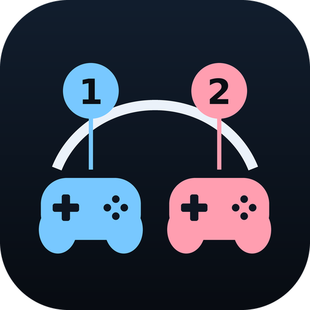
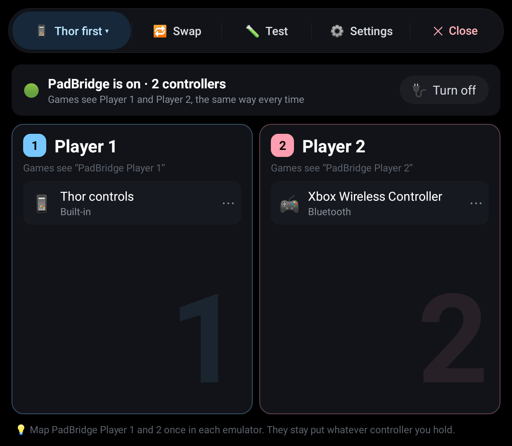
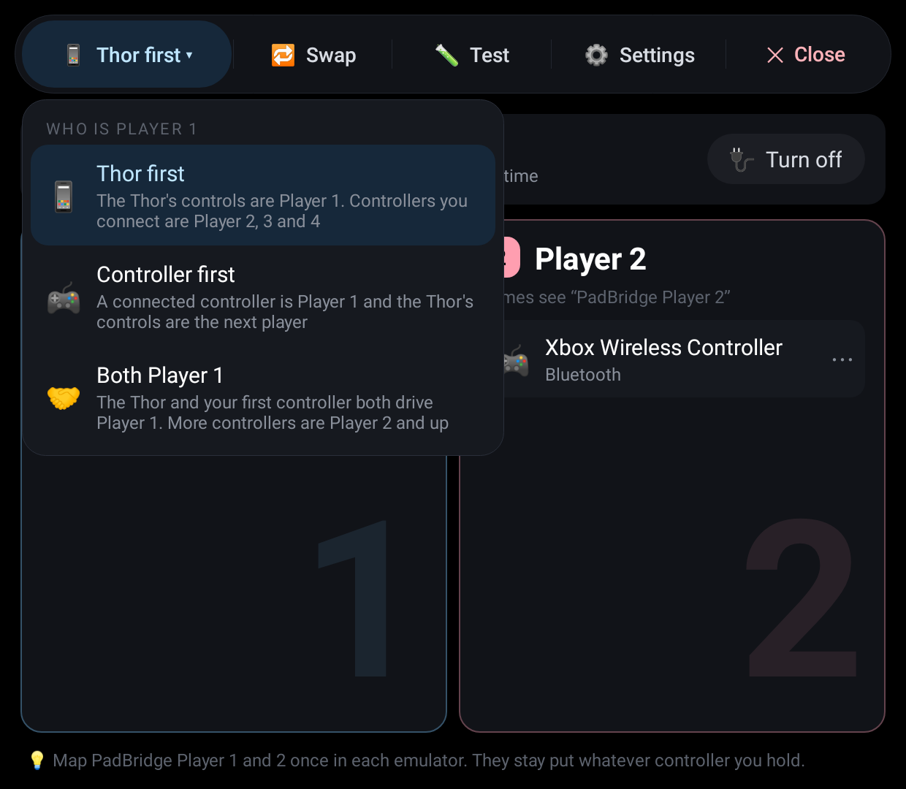
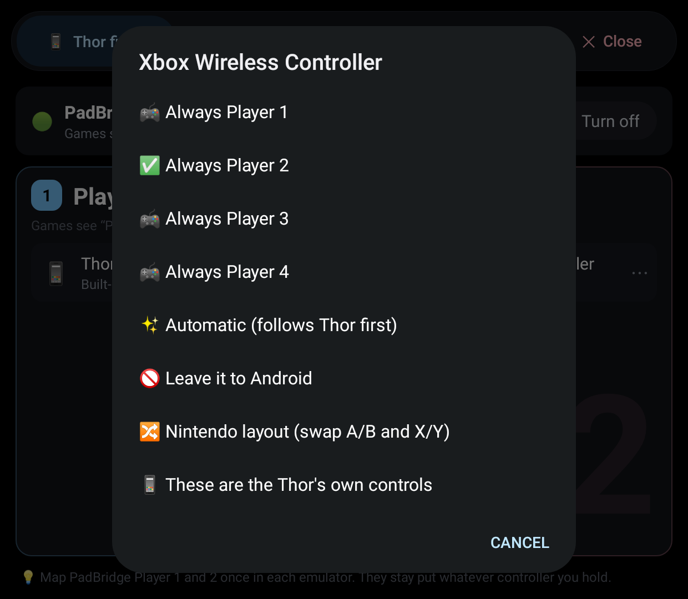
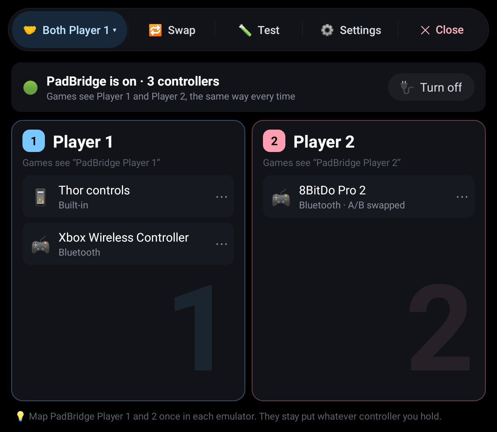
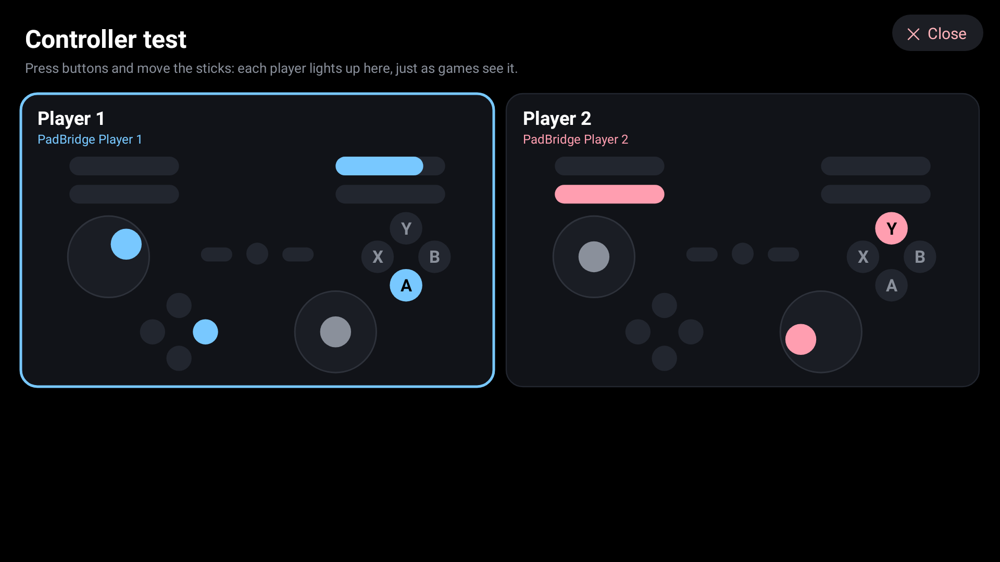
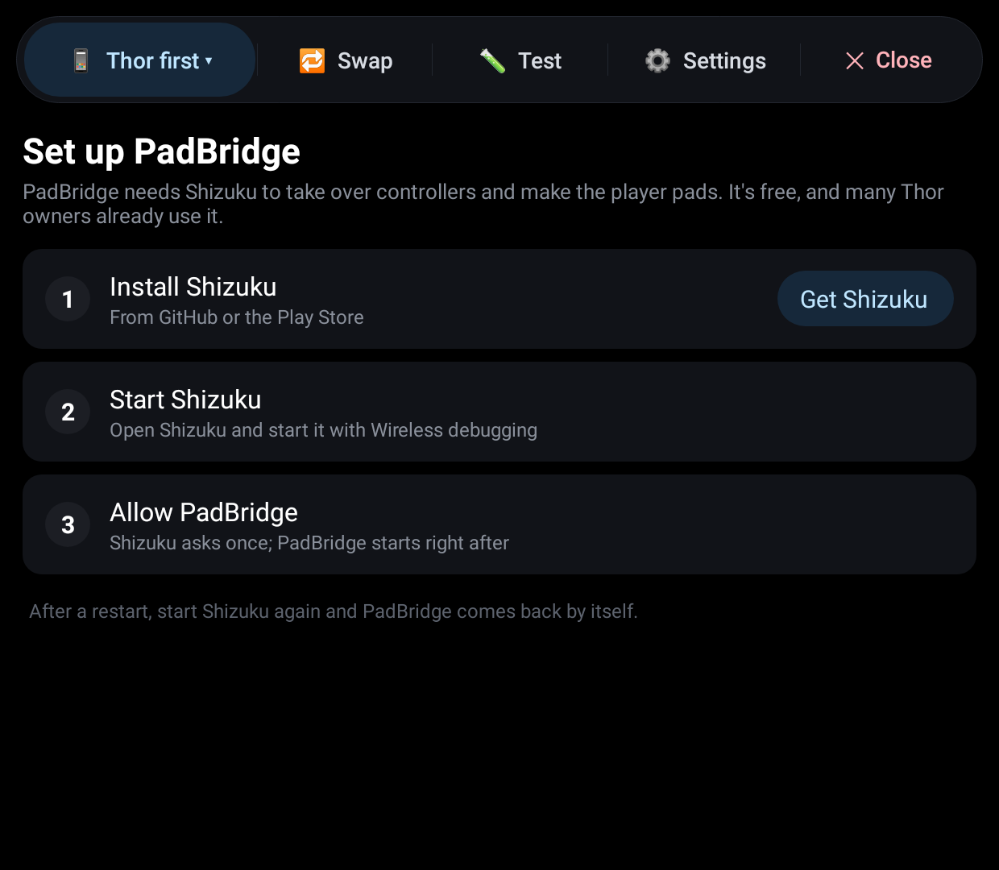
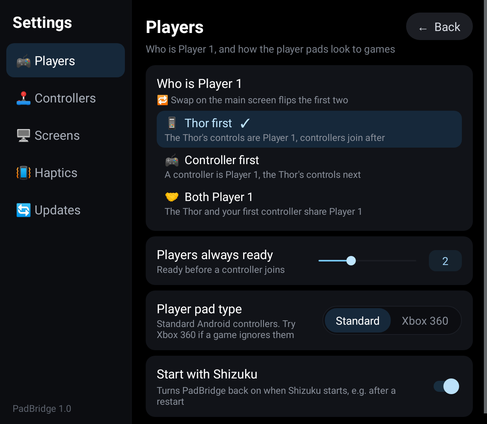
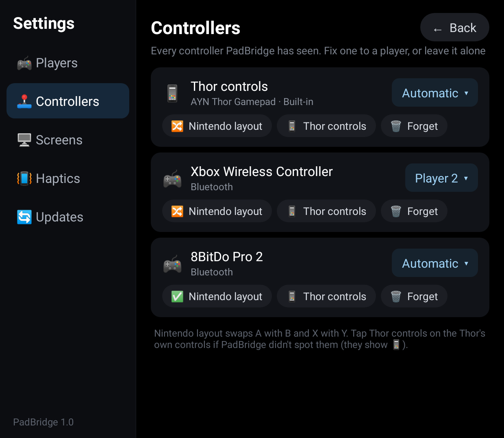

<p align="center"></p>

# PadBridge

[](https://github.com/ajhockey88/PadBridge/releases)
[](https://github.com/ajhockey88/PadBridge/releases/latest)

🎮 Use the AYN Thor's own controls and an external controller at the same time, with fixed players.

🔁 Tired of remapping your emulators every time you connect a controller to the Thor? PadBridge
takes over the Thor's controls and your controllers and gives games two steady controllers,
**PadBridge Player 1** and **PadBridge Player 2**, which look the same every time. Map them once
in each emulator and you're done, whichever controller you pick up.

## 📸 Screens

| 🎮 Players, on the bottom screen | 👆 Who is Player 1 |
|---|---|
|  |  |
| 🕹️ A controller's menu | 🤝 Both Player 1 |
|  |  |
| 🧪 Controller test (top screen) | 🚀 First-run setup |
|  |  |
| ⚙️ Settings | 🕹️ Controllers |
|  |  |

The screenshots are drawn from the app's own code with made-up controllers; pictures from a
Thor will replace them.

## 👆 Using it

PadBridge opens on the bottom screen, so the game on the top screen stays put. Each player has
a card with the controllers on it. Once it's on, you can close PadBridge: it keeps running.

- 📱 **Thor first** (the default): the Thor's controls are Player 1, and controllers you
  connect are Player 2, 3 and 4.
- 🎮 **Controller first**: a connected controller is Player 1 and the Thor's controls are the
  next player. Handy docked, when a friend can still join on the Thor.
- 🤝 **Both Player 1**: the Thor and your first controller both drive Player 1, so you can put
  the Thor down and pick up a controller mid-game. More controllers are Player 2 and up.
- 🔁 **Swap** flips Player 1 and Player 2 in one tap.
- ⋯ **Tap a controller** to fix it to a player (📌 it stays there whatever the mode), leave it to
  Android, swap A/B and X/Y for Nintendo-style controllers, or mark it as the Thor's own controls
  if PadBridge didn't spot them.
- 🧪 **Test** opens the controller test on the top screen: every player pad drawn live, so you
  can check who's who before starting a game.

The menu along the top has the mode, 🔁 Swap, 🧪 Test, ⚙️ Settings and ✖️ Close. Every
button works with a controller too.

**In your emulators:** map **PadBridge Player 1** to port 1 and **PadBridge Player 2** to port
2, once. The real controllers PadBridge took over stay silent, so they don't claim a port of
their own.

## ⚙️ Settings

- 🎮 **Players:** who is Player 1, how many player pads are always ready (2 by default, so
  Player 2 is there before a friend connects), and the player pad type: **Standard** Android
  controllers, or **Xbox 360** for games that only know Xbox controllers.
- 🔌 **Start with Shizuku** (on by default): PadBridge comes back on by itself when Shizuku
  starts, for example after a restart.
- 🖥️ **Screens:** **Test on the other screen** and **Swap screens**.
- 🕹️ **Controllers:** every controller PadBridge has seen, with its player, Nintendo layout,
  Thor controls (to mark the Thor's own controls) and Forget.
- 📳 **Haptics:** a feel (Off, Tick, Click, Heavy, Double or Buzz) and strength for each action,
  with a preview as you change them.
- 🔄 **Updates:** **Check for updates** and **Reinstall**, as in ThorPad.

Long-press a heading in Settings to save diagnostics to Download (PadBridge's log, the input
devices and screenshots), for bug reports.

## 📲 Install

1. Copy `PadBridge.apk` to the Thor and open it to install.
2. Install [Shizuku](https://github.com/RikkaApps/Shizuku/releases/latest) and start it (with
   Wireless debugging).
3. Open PadBridge and tap **Allow** when Shizuku asks. PadBridge turns on right away.
4. Connect a controller. It shows up on its player's card.

After a restart, start Shizuku again and PadBridge comes back by itself.

🔄 **Updating:** PadBridge checks for a new version when it opens, or tap **Check for updates** in
Settings > Updates. You can also install the newest `PadBridge.apk` from
[Releases](https://github.com/ajhockey88/PadBridge/releases) over the old one.

## 🛠️ How it works

PadBridge's engine runs on its own as Android's shell user, started through Shizuku, so it keeps
going after you close the app. Every second it reads Linux's list of input devices
(`/proc/bus/input/devices`) for controllers coming and going.

For each controller that gets a player, the engine opens its `/dev/input` node and grabs it
(`EVIOCGRAB`), so its own input stops reaching Android and games. It reads every button, stick
and trigger, scales them against that controller's own ranges, and passes them to its player's
pad. The player pads are made with Android's built-in `uinput` tool: virtual USB controllers with
fixed names, maker and model, which Android identifies the same way every time. A trigger that
is only a button pushes its axis fully, and an analog trigger presses its button past halfway,
so every controller looks the same through a player pad. When PadBridge is switched off, or a
controller is left to Android, the engine lets go and Android sees the controller as usual.

The app and the engine talk through two small files in PadBridge's own folder: the app writes
the settings, the engine writes what it's doing.

🔒 PadBridge only goes online to check GitHub for updates (when it opens, and from Settings).
It reads controller input only to pass it on, and never stores or sends it anywhere.

## 🙏 Credits

The idea comes from [Docking Enhancer](https://github.com/Ezequiel-CE/Docking-Enhancer) by
Ezequiel-CE, which replays an external controller onto the AYN Odin's built-in controller.
PadBridge is its own code, written for the Thor: it uses Shizuku and Android's `uinput` tool
instead of the Odin firmware's privileged service, and adds stable players for two or more
controllers.

## 🏗️ Building

`./build.sh` builds `build/PadBridge.apk` with Ubuntu's packaged Android tools (see the script
header); it downloads the two jars it compiles against from Maven Central. The project also has
standard Gradle files, so it can be opened and built in Android Studio.

The engine's logic (finding controllers, reading them, picking players, what the player pads
report) can be checked on a desktop JVM, no Android needed:

```
javac -d build/test -cp deps/android-all-14-robolectric-10818077.jar \
    app/src/main/java/com/padbridge/{Evdev,PadState,InputScan,PadMapper,Routing,PlayerPad}.java test/EngineTest.java
java -cp build/test:deps/android-all-14-robolectric-10818077.jar com.padbridge.EngineTest
```

The signing key is not in this repository. `build.sh` reads it from `keystore/padbridge.jks`
(or `$KEYSTORE`) and creates a new one if missing; an APK signed with a different key has to be
uninstalled before it can replace an older install.

### Releasing

Bump `versionCode` and `versionName` in `app/build.gradle` and `AndroidManifest.xml` and build
with the usual key. Then commit `release/PadBridge.apk` and `release/notes.md` on top of `main`
and push that commit as a `release/v1.0` branch (not to `main`). The Release workflow tags it
`v1.0`, publishes the release, and deletes the branch; the app's update check finds it.
